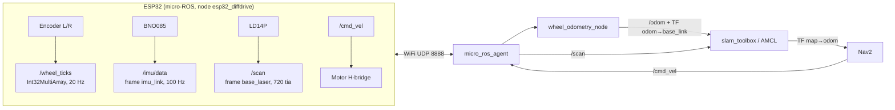
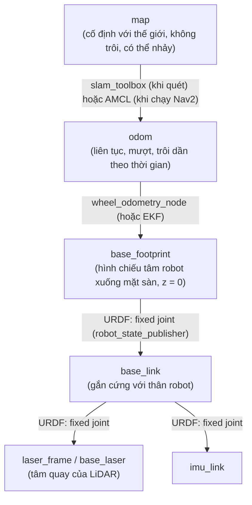

# Hướng dẫn thực hành SLAM & Nav2 cho Small Autonomous Mobile Robot

> Tài liệu này được viết dựa trên **mã nguồn thực tế** trong repository: package `ros2_ws/src/wheel_odometry`
> (node C++, launch, config) và firmware `ESP32-based robot/10_Final_Code/main.cpp`.
> Môi trường mục tiêu: **Ubuntu 24.04 + ROS 2 Jazzy** (khớp với đường dẫn `/opt/ros/jazzy/...` trong README),
> micro-ROS qua **WiFi UDP**, LiDAR **LD14P**, IMU **BNO085**, encoder bánh xe.

---

## Mục lục

0. [Phân tích cấu trúc repository](#0-phân-tích-cấu-trúc-repository)
1. [Cây tọa độ TF & URDF](#1-cây-tọa-độ-tf--urdf)
2. [Quy trình chạy thực tế trên Terminal](#2-quy-trình-chạy-thực-tế-trên-terminal)
3. [Bảng xử lý 10 lỗi thực tế hay gặp nhất](#3-bảng-xử-lý-10-lỗi-thực-tế-hay-gặp-nhất)
4. [Phụ lục: checklist trước mỗi lần chạy](#4-phụ-lục-checklist-trước-mỗi-lần-chạy)

---

## 0. Phân tích cấu trúc repository

### 0.1 Cây thư mục liên quan đến ROS 2

```text
Small_Autonomous_Mobile_Robot/
├── ESP32-based robot/
│   ├── 01 … 05_*/                  # Các bước học dần: Serial, WiFi, motor, IMU, encoder
│   └── 10_Final_Code/
│       ├── main.cpp                # Firmware micro-ROS cuối cùng (ESP32-WROOM-32, TRACK = 0.165)
│       ├── main2.cpp               # Biến thể (TRACK = 0.163)
│       └── platformio.ini          # board esp32doit-devkit-v1, micro-ROS distro = humble, transport = wifi
└── ros2_ws/
    ├── maps/
    │   ├── test_map.pgm            # Bản đồ mẫu đã quét
    │   └── test_map.yaml           # resolution 0.05, origin [-1.943, -2.933, 0]
    └── src/wheel_odometry/         # Package ROS 2 duy nhất (ament_cmake)
        ├── src/
        │   ├── wheel_odometry_node.cpp   # /wheel_ticks -> /odom + TF odom->base_link
        │   └── scan_restamper.cpp        # /scan_raw -> /scan (đóng dấu lại thời gian)
        ├── config/
        │   ├── odom_params.yaml    # Bán kính bánh, track width, ticks/rev, publish_tf
        │   ├── slam_params.yaml    # slam_toolbox (online async, mapping)
        │   ├── nav2_params.yaml    # AMCL, planner, controller (RPP), costmap, smoother, collision monitor
        │   └── ekf.yaml            # robot_localization (CHƯA được launch nào sử dụng)
        └── launch/
            ├── robot_base.launch.py        # 2 static TF + wheel_odometry_node + scan_restamper
            ├── static_transforms.launch.py # Chỉ 2 static TF (bản tách riêng)
            ├── mapping.launch.py           # robot_base + slam_toolbox (trễ 5 s)
            └── navigation.launch.py        # robot_base + map_server + AMCL + toàn bộ Nav2
```

### 0.2 Luồng dữ liệu tổng thể



### 0.3 Topic, frame và thông số chính

| Thành phần | Giá trị thực tế trong code | Nơi định nghĩa |
|---|---|---|
| Node trên ESP32 | `esp32_diffdrive` | `main.cpp` |
| Topic encoder | `/wheel_ticks` (`std_msgs/Int32MultiArray`, `[left, right]`, chu kỳ 50 ms) | `main.cpp` |
| Topic IMU | `/imu/data`, `frame_id = imu_link`, chu kỳ 10 ms | `main.cpp` |
| Topic LiDAR | `/scan`, `frame_id = base_laser`, 720 tia, `[-π, π)`, range 0.10–8.0 m | `main.cpp` |
| Lệnh vận tốc | `/cmd_vel` (`geometry_msgs/Twist`), watchdog dừng xe sau 250 ms | `main.cpp` |
| Bán kính bánh | `0.0335 m` | `odom_params.yaml` |
| Khoảng cách 2 bánh | `0.163 m` (odom) / `0.165 m` (firmware `main.cpp`) ⚠️ | `odom_params.yaml`, `main.cpp` |
| Ticks / vòng | `585` | `odom_params.yaml` |
| Frame robot | `base_link` (không có `base_footprint`) | mọi file config |
| Static TF LiDAR | `base_link → base_laser`: z = 0.04125 m, yaw = 0 | `robot_base.launch.py` |
| Static TF IMU | `base_link → imu_link`: (-0.0674, 0.006355, -0.0053), yaw = -1.57 | `robot_base.launch.py` |
| Controller Nav2 | Regulated Pure Pursuit, 0.30 m/s, không lùi, không xoay-về-hướng | `nav2_params.yaml` |
| Kích thước robot | `robot_radius: 0.22`, `inflation_radius: 0.35` | `nav2_params.yaml` |

### 0.4 Những điểm bất nhất phát hiện được khi đọc code (nên biết trước khi chạy)

Đây là những chỗ trong repo **hiện tại** có thể gây lỗi. Phần 3 sẽ đối chiếu lại từng điểm.

1. **Không có URDF / `robot_state_publisher`.** Cây TF được dựng thủ công bằng `static_transform_publisher`.
   Frame gốc của robot là `base_link`, **không có `base_footprint`**, LiDAR tên là `base_laser` (không phải `laser_frame`).
2. **`scan_restamper` gần như không hoạt động:** node này nghe `/scan_raw`, nhưng firmware lại publish thẳng lên `/scan`.
   Vậy `/scan` mà SLAM/Nav2 nhận là dữ liệu gốc từ ESP32, còn restamper ngồi chờ một topic không ai publish.
   Muốn dùng restamper thì phải đổi topic trong firmware thành `"scan_raw"`.
3. **Đường dẫn map mặc định trong `navigation.launch.py` bị sai:** mặc định là `share/wheel_odometry/maps/my_map.yaml`,
   nhưng `CMakeLists.txt` không cài thư mục `maps/`, và bản đồ lại nằm ở `ros2_ws/maps/`. **Luôn truyền `map:=...`**.
4. **Chuỗi `cmd_vel` của Nav2 có thể bị đứt/khép vòng:** `controller_server` được remap sang `cmd_vel_nav`,
   nhưng `velocity_smoother` **không có remap**, nên nó nghe `/cmd_vel` (đúng topic mà `collision_monitor` xuất ra).
   Hệ quả: lệnh của controller không đi tới xe, đồng thời tạo vòng lặp `cmd_vel → smoother → collision_monitor → cmd_vel`.
   Xem lỗi số 8 để kiểm tra và sửa.
5. **Đồng bộ thời gian chỉ chạy một lần lúc khởi động** (`rmw_uros_sync_session(1000)`), và kết quả bị bỏ qua.
   Nếu sync thất bại, mọi message có `stamp = 0`, dẫn đến lỗi TF extrapolation (lỗi số 3).
6. **Firmware không có cơ chế kết nối lại agent:** mọi lỗi `RCCHECK` đều rơi vào `error_loop()` (vòng lặp vô hạn).
   Nếu agent khởi động sau ESP32 hoặc bị tắt giữa chừng, ESP32 "chết" cho tới khi bấm reset (lỗi số 1).
7. **Phiên bản micro-ROS không khớp:** `platformio.ini` dùng `board_microros_distro = humble`, còn PC chạy Jazzy.
   Nên đặt `board_microros_distro = jazzy` để khớp với agent.
8. **`ekf.yaml` có `publish_tf: true`, trong khi `odom_params.yaml` cũng có `publish_tf: true`.** Hiện chưa launch EKF nên chưa sao,
   nhưng nếu bật EKF mà không tắt TF của wheel odometry thì sẽ có **2 node cùng publish `odom → base_link`**.
9. **`min_x_velocity_threshold: 0.25` trong `controller_server`** rất lớn (mặc định 0.001): mọi vận tốc odom < 0.25 m/s bị coi là 0,
   trong khi tốc độ mong muốn chỉ 0.30 m/s.
10. README mô tả firmware ESP32-S3 hai lõi, nhưng mã trong `10_Final_Code` là bản cho **ESP32-WROOM-32** (`esp32doit-devkit-v1`,
    chân encoder 34/35, I²C 21/22). Hãy chắc chắn bạn nạp đúng bản firmware cho đúng board.

---

## 1. Cây tọa độ TF & URDF

### 1.1 Chuỗi chuẩn theo REP-105



Nguyên tắc quan trọng nhất: **mỗi frame chỉ có đúng MỘT cha và đúng MỘT node publish nó.**

| Transform | Ai publish | Tần số | Ý nghĩa |
|---|---|---|---|
| `map → odom` | `slam_toolbox` (mapping) **hoặc** `amcl` (navigation), không bao giờ cả hai | ~ theo scan | Bù sai số trôi của odometry |
| `odom → base_footprint` | `wheel_odometry_node` (hoặc `ekf_node`) | 50 Hz | Vị trí robot tính từ encoder |
| `base_footprint → base_link` | `robot_state_publisher` từ URDF | static | Độ cao trục bánh so với sàn |
| `base_link → laser_frame` | `robot_state_publisher` từ URDF | static | Vị trí lắp LiDAR |

Vì sao `map → odom` mà không phải `map → base_link`? Vì một frame chỉ có một cha. SLAM/AMCL tính ra vị trí đúng
`map → base_link`, rồi **trừ đi** `odom → base_link` để ra `map → odom`. Nhờ vậy odometry vẫn mượt, còn sai số trôi
được dồn hết vào một transform duy nhất.

### 1.2 Cây TF hiện tại của repo

Repo **không có URDF**. Cây TF thực tế khi chạy `mapping.launch.py` là:

```text
map ──(slam_toolbox)──> odom ──(wheel_odometry_node)──> base_link ──(static)──> base_laser
                                                                 └─(static)──> imu_link
```

Tức là `base_link` đang đóng vai trò của `base_footprint` (odometry luôn publish `z = 0`).
Cách này **hoàn toàn chạy được** với 2D SLAM/Nav2, chỉ cần mọi tham số frame đều thống nhất là `base_link`.

Bảng đối chiếu tham số frame (tất cả phải khớp nhau):

| File | Tham số | Giá trị hiện tại |
|---|---|---|
| `odom_params.yaml` | `odom_frame` / `base_frame` | `odom` / `base_link` |
| `slam_params.yaml` | `map_frame` / `odom_frame` / `base_frame` | `map` / `odom` / `base_link` |
| `nav2_params.yaml` → `amcl` | `global_frame_id` / `odom_frame_id` / `base_frame_id` | `map` / `odom` / `base_link` |
| `nav2_params.yaml` → `bt_navigator`, costmap, `behavior_server` | `robot_base_frame` | `base_link` |
| `nav2_params.yaml` → `collision_monitor` | `base_frame_id` | `base_link` |
| `main.cpp` (firmware) | `scan_msg.header.frame_id` | `base_laser` |
| `main.cpp` (firmware) | `imu_msg.header.frame_id` | `imu_link` |
| `robot_base.launch.py` | `--child-frame-id` | `base_laser`, `imu_link` |

### 1.3 (Tùy chọn) Chuyển sang URDF chuẩn có `base_footprint`

Nên làm khi bạn muốn hiển thị mô hình robot trong RViz, hoặc thêm cảm biến khác. File mẫu bên dưới **chưa có trong repo**;
bạn tạo mới `ros2_ws/src/wheel_odometry/urdf/robot.urdf`. Kích thước lấy từ config hiện tại; các giá trị đánh dấu
`ĐO LẠI` phải đo trên robot thật.

```xml
<?xml version="1.0"?>
<robot name="small_amr">

  <!-- Hình chiếu tâm robot xuống sàn. Không có hình học. -->
  <link name="base_footprint"/>

  <!-- Thân robot. Gốc đặt tại tâm trục bánh, cao bằng bán kính bánh (0.0335 m). -->
  <link name="base_link">
    <visual>
      <origin xyz="0 0 0.02"/>
      <geometry><cylinder radius="0.11" length="0.06"/></geometry>   <!-- ĐO LẠI -->
      <material name="grey"><color rgba="0.6 0.6 0.6 1"/></material>
    </visual>
  </link>

  <joint name="base_footprint_joint" type="fixed">
    <parent link="base_footprint"/>
    <child  link="base_link"/>
    <origin xyz="0 0 0.0335" rpy="0 0 0"/>         <!-- = wheel_radius -->
  </joint>

  <!-- LiDAR LD14P. Tên link phải TRÙNG với frame_id trong firmware ("base_laser"). -->
  <link name="base_laser">
    <visual>
      <geometry><cylinder radius="0.02" length="0.03"/></geometry>
      <material name="black"><color rgba="0.1 0.1 0.1 1"/></material>
    </visual>
  </link>

  <joint name="laser_joint" type="fixed">
    <parent link="base_link"/>
    <child  link="base_laser"/>
    <!-- Tổng z(base_footprint→base_link) + z(base_link→base_laser) phải bằng
         chiều cao THẬT của tâm quét LiDAR so với sàn.  ĐO LẠI -->
    <origin xyz="0 0 0.04125" rpy="0 0 0"/>
  </joint>

  <!-- IMU BNO085 -->
  <link name="imu_link"/>
  <joint name="imu_joint" type="fixed">
    <parent link="base_link"/>
    <child  link="imu_link"/>
    <origin xyz="-0.0674 0.006355 -0.0053" rpy="0 0 -1.5708"/>
  </joint>

  <!-- Bánh xe khai báo "fixed" để không cần /joint_states.
       Nếu dùng "continuous" thì phải có joint_state_publisher, nếu không
       robot_state_publisher sẽ không publish TF của bánh. -->
  <link name="left_wheel">
    <visual><origin rpy="1.5708 0 0"/><geometry><cylinder radius="0.0335" length="0.02"/></geometry></visual>
  </link>
  <joint name="left_wheel_joint" type="fixed">
    <parent link="base_link"/><child link="left_wheel"/>
    <origin xyz="0 0.0815 0"/>                     <!-- track_width / 2 -->
  </joint>
  <link name="right_wheel">
    <visual><origin rpy="1.5708 0 0"/><geometry><cylinder radius="0.0335" length="0.02"/></geometry></visual>
  </link>
  <joint name="right_wheel_joint" type="fixed">
    <parent link="base_link"/><child link="right_wheel"/>
    <origin xyz="0 -0.0815 0"/>
  </joint>
</robot>
```

Thay hai node `static_transform_publisher` trong `robot_base.launch.py` bằng:

```python
urdf_path = os.path.join(pkg, 'urdf', 'robot.urdf')
with open(urdf_path, 'r') as f:
    robot_description = f.read()

Node(
    package='robot_state_publisher',
    executable='robot_state_publisher',
    parameters=[{'robot_description': robot_description}],
    output='screen',
),
```

Và thêm vào `CMakeLists.txt`:

```cmake
install(DIRECTORY urdf/ DESTINATION share/${PROJECT_NAME}/urdf)
```

Sau đó **đổi `base_link` → `base_footprint`** ở mọi tham số "khung gốc của robot" trong bảng mục 1.2
(`odom_params.yaml: base_frame`, `slam_params.yaml: base_frame`, `amcl: base_frame_id`, `robot_base_frame` của
`bt_navigator`/`local_costmap`/`global_costmap`/`behavior_server`, `collision_monitor: base_frame_id`, `ekf.yaml: base_link_frame`).

> ⚠️ **Quên xóa static TF cũ** trong khi đã chạy `robot_state_publisher` → `base_laser` có hai nguồn publish,
> RViz báo lỗi TF nhấp nháy. **Đổi một nửa số tham số** (ví dụ odom publish `odom→base_footprint` nhưng AMCL vẫn dùng
> `base_link`) → TF vẫn nối được nhưng robot bị lệch độ cao, và nếu thiếu joint `base_footprint→base_link` thì cây TF bị tách đôi.

### 1.4 Quy ước trục REP-103: nền tảng để không bị xoay bản đồ

| Trục | Hướng | Kiểm tra trên robot thật |
|---|---|---|
| **+X** | Phía trước robot | Đẩy xe tiến → `/odom` `pose.position.x` tăng |
| **+Y** | Bên **trái** robot | Vật đặt bên trái → trong RViz nằm phía +Y của `base_link` |
| **+Z** | Hướng lên trên | Lên trời |
| **+yaw** | Quay **ngược chiều kim đồng hồ** (nhìn từ trên xuống) | Xoay xe sang trái bằng tay → yaw tăng; `angular.z > 0` → xe rẽ trái |
| LiDAR góc 0 | Hướng +X (phía trước), góc dương về bên trái | Firmware đã đổi `θ_ros = −θ_ld14` để đạt điều này |

### 1.5 Các lỗi lệch trục phổ biến khiến bản đồ SLAM bị xoay hoặc chồng hình

| # | Triệu chứng trên bản đồ | Nguyên nhân gốc | Cách kiểm tra | Cách sửa |
|---|---|---|---|---|
| 1 | **Tường "nhân đôi" thành hình rẻ quạt** mỗi khi xe quay, đi thẳng thì đẹp | Sai tỉ lệ góc quay của odometry: `track_width` sai, bánh trượt, hoặc `ticks_per_rev` sai | Quay xe tại chỗ đúng 360° (đánh dấu trên sàn), đọc yaw tích lũy trên `/odom` | Hiệu chỉnh `track_width`: `track_mới = track_cũ × (góc_odom / góc_thật)`. Hiệu chỉnh `ticks_per_rev` bằng cách lăn đúng 1.0 m |
| 2 | **Bản đồ bị lật gương** (phòng trái thành phải), xe đi thẳng mà scan trượt ngang | Scan LiDAR bị đảo chiều (CW thay vì CCW) | Đặt vật ở bên **trái** xe → trong RViz (Fixed Frame `base_link`) điểm phải nằm ở **+Y** | Giữ chuyển đổi `θ_ros = −θ_ld14` trong firmware. **Không** sửa bằng `roll = π` trong TF, vì sẽ lật luôn trục Z |
| 3 | **Bản đồ xoay 90° hoặc 180°** so với thực tế, xe đi tới mà scan đi lùi | LiDAR lắp xoay so với hướng tiến (cáp hướng ra sau…) nhưng TF vẫn để `yaw = 0` | Đặt vật ngay **trước** xe → trong RViz điểm phải nằm trên **+X** | Đặt đúng `--yaw` (ví dụ `3.14159`) trong `base_link → base_laser` |
| 4 | Xe đi tới mà trên bản đồ đi lùi, hoặc quay trái thành quay phải | Encoder trái/phải bị đảo dấu hoặc tráo kênh | `ros2 topic echo /wheel_ticks`: đẩy xe tiến → **cả hai** giá trị tăng; quay trái → phải tăng, trái giảm | `INVERT_LEFT_DIR` / `INVERT_RIGHT_DIR` trong firmware, hoặc tráo chân A/B |
| 5 | Bản đồ "nhòe" khi quay nhanh, dù odometry tốt | Timestamp của scan lệch thời gian thật (sync thời gian thất bại, độ trễ WiFi) | `ros2 topic echo /scan --field header.stamp` so với `date +%s` | Sửa đồng bộ thời gian (lỗi số 3), quay chậm (≤ 0.5 rad/s) khi quét |
| 6 | Bản đồ nhảy giật, RViz nhấp nháy pose robot | **Hai node** cùng publish `odom → base_link` (wheel odom + EKF) | `ros2 run tf2_ros tf2_monitor odom base_link` xem "Authority" | Chỉ để một nguồn: khi bật EKF đặt `publish_tf: false` trong `odom_params.yaml` |
| 7 | Xe quay tại chỗ mà scan vẽ một vòng cung nhỏ | LiDAR không ở tâm quay nhưng TF để `x = 0, y = 0` | Đo khoảng cách từ tâm trục bánh đến tâm LiDAR | Nhập đúng `--x`, `--y` cho `base_link → base_laser` |
| 8 | Bản đồ bị xoay chậm dần theo thời gian khi dùng EKF | IMU sai trục (`yaw = -1.57` không khớp cách lắp BNO085) | Quay xe sang trái → `/imu/data` `angular_velocity.z` phải **dương** | Sửa yaw của `base_link → imu_link` hoặc remap trục IMU trong firmware |

---

## 2. Quy trình chạy thực tế trên Terminal

> Quy ước: mỗi khối lệnh dưới đây chạy trong **một terminal riêng**. Mọi terminal đều phải `source` môi trường trước.
> Thư mục workspace giả định là `~/ros2_ws`.

### 2.0 Cài đặt và build (làm một lần)

Cài các package cần thiết:

```bash
sudo apt update && sudo apt install -y ros-jazzy-slam-toolbox ros-jazzy-navigation2 ros-jazzy-nav2-bringup ros-jazzy-teleop-twist-keyboard ros-jazzy-tf2-tools ros-jazzy-robot-state-publisher
```

Build package:

```bash
cd ~/ros2_ws && colcon build --symlink-install --packages-select wheel_odometry
```

Dòng `source` phải chạy trong **mỗi** terminal mới (hoặc thêm vào `~/.bashrc`):

```bash
source /opt/ros/jazzy/setup.bash && source ~/ros2_ws/install/setup.bash
```

Mở cổng UDP cho micro-ROS nếu dùng `ufw`:

```bash
sudo ufw allow 8888/udp
```

> 💡 Với `--symlink-install`, sửa file `.yaml`/`.py` không cần build lại. Sửa file `.cpp` thì phải build lại.

### 2.1 Bước 1: Khởi động micro-ROS Agent (luôn chạy TRƯỚC khi cấp điện ESP32)

**Terminal 1:**

```bash
ros2 run micro_ros_agent micro_ros_agent udp4 --port 8888 -v6
```

Sau đó **bấm nút RESET/EN trên ESP32**. Log agent phải có các dòng `create_client`, `create_participant`,
`create_topic`, `create_publisher`, `create_subscriber`.

> Vì firmware không có cơ chế kết nối lại, **thứ tự bắt buộc là: Agent → reset ESP32**. Nếu khởi động agent sau thì ESP32
> đã kẹt trong `error_loop()`.

Kiểm tra node ESP32 đã lên mạng ROS 2:

```bash
ros2 node list
```

Kết quả mong đợi có `/esp32_diffdrive`.

```bash
ros2 node info /esp32_diffdrive
```

Kết quả mong đợi: Publishers gồm `/imu/data`, `/scan`, `/wheel_ticks`; Subscribers gồm `/cmd_vel`.

### 2.2 Bước 2: Kiểm tra dữ liệu cảm biến

#### a) Danh sách topic và kiểu dữ liệu

```bash
ros2 topic list -t
```

#### b) `ros2 topic echo`: xem nội dung

Xem một bản tin scan, chỉ phần header, để kiểm tra `frame_id` và `stamp`:

```bash
ros2 topic echo /scan --once --field header
```

Mong đợi: `frame_id: base_laser`, `stamp.sec` là **thời gian Unix hiện tại** (khoảng 1.7×10⁹), **không phải 0**.
Nếu `sec: 0` thì đồng bộ thời gian đã thất bại (xem lỗi số 3).

So sánh nhanh với đồng hồ PC:

```bash
date +%s
```

Xem dữ liệu encoder rồi đẩy xe tiến bằng tay khoảng 20 cm:

```bash
ros2 topic echo /wheel_ticks --field data
```

Mong đợi: **cả hai** số đều tăng, và tăng xấp xỉ bằng nhau. Một số giảm nghĩa là encoder bên đó bị đảo chiều.

Xem IMU rồi xoay xe sang trái bằng tay:

```bash
ros2 topic echo /imu/data --field angular_velocity
```

Mong đợi: `z` **dương** khi quay ngược chiều kim đồng hồ.

#### c) `ros2 topic hz`: kiểm tra tần số

```bash
ros2 topic hz /wheel_ticks
```

Mong đợi khoảng **20 Hz** (timer 50 ms).

```bash
ros2 topic hz /imu/data
```

Mong đợi tối đa **100 Hz** (timer 10 ms). Qua WiFi thường thấp hơn một chút.

```bash
ros2 topic hz /scan
```

Mong đợi khoảng **6–10 Hz** (tốc độ quay của LD14P). Nếu < 3 Hz hoặc dao động mạnh, WiFi đang quá tải (xem lỗi số 2).

Đo băng thông của scan (720 tia × 2 mảng float là khoảng 5.8 kB mỗi bản tin):

```bash
ros2 topic bw /scan
```

Kiểm tra QoS, vì Nav2/SLAM cần QoS tương thích với publisher:

```bash
ros2 topic info /scan -v
```

#### d) Khởi động phần nền của robot (odometry + static TF)

**Terminal 2:**

```bash
ros2 launch wheel_odometry robot_base.launch.py
```

Log phải in bảng tham số `WheelOdometryNode parameters` và dòng `First tick received. Odometry initialised at (0, 0, 0).`

Kiểm tra odometry:

```bash
ros2 topic hz /odom
```

Mong đợi khoảng **50 Hz**.

```bash
ros2 topic echo /odom --field pose.pose
```

Đẩy xe tiến 1 m → `position.x ≈ 1.0`. Quay xe sang trái 90° → `orientation.z ≈ 0.707`, `w ≈ 0.707`.

#### e) `view_frames` và `tf2_echo`: kiểm tra cây TF

Xuất sơ đồ cây TF ra file PDF (ghi vào thư mục hiện tại, tên `frames_<thời_gian>.pdf`):

```bash
cd ~ && ros2 run tf2_tools view_frames
```

Mở file PDF vừa tạo:

```bash
xdg-open $(ls -t ~/frames_*.pdf | head -1)
```

Ở bước này (chưa chạy SLAM), cây đúng là `odom → base_link → {base_laser, imu_link}`. Kiểm tra trong PDF:
- Mỗi frame chỉ có **một mũi tên vào**.
- `odom → base_link` có "Average rate" khoảng 50 Hz, "Broadcaster" là `/wheel_odometry_node`.
- Static TF hiển thị rate rất cao hoặc `static`.

Xem trực tiếp một transform:

```bash
ros2 run tf2_ros tf2_echo base_link base_laser
```

Mong đợi: `Translation: [0.000, 0.000, 0.041]`, `Rotation: RPY [0, 0, 0]`.

Theo dõi độ trễ TF và node đang publish nó:

```bash
ros2 run tf2_ros tf2_monitor odom base_link
```

#### f) Kiểm tra chiều quay của motor (QUAN TRỌNG trước khi chạy Nav2)

Kê bánh xe lên khỏi mặt đất, gửi lệnh quay trái:

```bash
ros2 topic pub -r 5 /cmd_vel geometry_msgs/msg/Twist "{linear: {x: 0.0}, angular: {z: 0.8}}"
```

Nhìn từ trên xuống, xe phải quay **ngược chiều kim đồng hồ** (bánh phải tiến, bánh trái lùi), và `/odom` yaw phải **tăng**.
Nhấn `Ctrl+C` để dừng; watchdog trong firmware sẽ dừng motor sau 250 ms.

### 2.3 Bước 3: Lái xe quét bản đồ 2D bằng `slam_toolbox`

#### a) Khởi động SLAM

Dừng `robot_base.launch.py` ở Terminal 2 (vì `mapping.launch.py` đã include nó), rồi chạy:

**Terminal 2:**

```bash
ros2 launch wheel_odometry mapping.launch.py
```

`slam_toolbox` khởi động sau 5 giây (`TimerAction`). Chờ dòng log có `Registering sensor: [Custom Described Lidar]`.

Kiểm tra `map → odom` đã xuất hiện:

```bash
ros2 run tf2_ros tf2_echo map odom
```

#### b) Mở RViz2

**Terminal 3:**

```bash
rviz2 -d /opt/ros/jazzy/share/nav2_bringup/rviz/nav2_default_view.rviz
```

Cấu hình trong RViz:
1. **Global Options → Fixed Frame** = `map`.
2. `Add → By topic → /map → Map` (đặt *Durability Policy* = `Transient Local`).
3. `Add → By topic → /scan → LaserScan` (đặt *Size* = 0.03).
4. `Add → TF` để thấy trục các frame.

#### c) Lái xe bằng bàn phím

**Terminal 4:**

```bash
ros2 run teleop_twist_keyboard teleop_twist_keyboard
```

Phím `i` tiến, `,` lùi, `j`/`l` quay trái/phải, `k` dừng. Nhấn `z` vài lần để giảm tốc xuống khoảng **0.15 m/s** và **0.4 rad/s**.

Kỹ thuật quét bản đồ đẹp:
- **Đứng yên 3–5 giây** ở vị trí xuất phát để SLAM có scan đầu tiên ổn định.
- **Đi chậm, quay chậm**. Quay là nguồn sai số lớn nhất với robot 2 bánh vi sai.
- Đi men theo tường, cách tường khoảng 0.5–1 m (LD14P bắt tốt trong khoảng 0.1–8 m).
- **Khép vòng (loop closure):** cuối cùng quay lại đúng điểm xuất phát để `slam_toolbox` tối ưu lại đồ thị (`do_loop_closing: true`).
- Tránh môi trường quá trống (hành lang dài không đặc điểm), kính, gương, vật đen hấp thụ laser.
- Theo dõi RViz: nếu tường bắt đầu nhân đôi thì dừng lại, lùi về vùng đã quét tốt, đứng yên vài giây.

#### d) Lưu bản đồ

Giữ nguyên SLAM đang chạy, mở **Terminal 5**:

```bash
mkdir -p ~/ros2_ws/maps
```

Lưu bản đồ chuẩn cho Nav2 (tạo `my_map.pgm` + `my_map.yaml`):

```bash
ros2 run nav2_map_server map_saver_cli -f ~/ros2_ws/maps/my_map --ros-args -p map_subscribe_transient_local:=true
```

Thành công khi log in `Map saved successfully`. Mở file yaml để kiểm tra:

```bash
cat ~/ros2_ws/maps/my_map.yaml
```

(Tùy chọn) Lưu thêm pose-graph của `slam_toolbox` để sau này quét tiếp hoặc định vị bằng SLAM thay cho AMCL:

```bash
ros2 service call /slam_toolbox/serialize_map slam_toolbox/srv/SerializePoseGraph "{filename: '$HOME/ros2_ws/maps/my_map'}"
```

> Ý nghĩa `my_map.yaml`: `resolution` (m/pixel), `origin` (tọa độ thế giới của pixel góc dưới-trái),
> `occupied_thresh`/`free_thresh` (ngưỡng xác suất chiếm chỗ). Khi sửa ảnh `.pgm` bằng GIMP (xóa vật thể tạm),
> **không được đổi kích thước ảnh**, nếu không `origin` sẽ sai.

Dừng tất cả (`Ctrl+C`) trước khi chuyển sang Nav2: **không chạy SLAM và AMCL cùng lúc**, vì cả hai đều publish `map → odom`.

### 2.4 Bước 4: Tự hành điểm-tới-điểm bằng Nav2

#### a) (Khuyến nghị) Sửa chuỗi `cmd_vel` trước khi chạy

Xem lỗi số 8. Tóm tắt: thêm remap cho `velocity_smoother` trong `navigation.launch.py`:

```python
Node(
    package='nav2_velocity_smoother',
    executable='velocity_smoother',
    name='velocity_smoother',
    output='screen',
    parameters=[nav2_config],
    remappings=[('cmd_vel', 'cmd_vel_nav')],   # <-- thêm dòng này
),
```

Chuỗi đúng sẽ là: `controller_server → /cmd_vel_nav → velocity_smoother → /cmd_vel_smoothed → collision_monitor → /cmd_vel → ESP32`.

#### b) Khởi động

**Terminal 1** vẫn chạy agent (bước 2.1). Reset ESP32 nếu cần.

**Terminal 2:** luôn truyền đường dẫn map tuyệt đối:

```bash
ros2 launch wheel_odometry navigation.launch.py map:=$HOME/ros2_ws/maps/my_map.yaml
```

Chờ dòng `Managed nodes are active` từ `lifecycle_manager_navigation`. Kiểm tra từng node:

```bash
ros2 lifecycle get /map_server
```

```bash
ros2 lifecycle get /amcl
```

```bash
ros2 lifecycle get /controller_server
```

Mỗi lệnh phải trả về `active [3]`.

**Terminal 3:**

```bash
rviz2 -d /opt/ros/jazzy/share/nav2_bringup/rviz/nav2_default_view.rviz
```

Lúc này bản đồ đã hiện, nhưng **chưa có TF `map → odom`** (RViz báo `Frame [map] does not exist` cho robot model/scan).
Đó là bình thường, vì AMCL chưa biết robot đang ở đâu.

#### c) `2D Pose Estimate`: cho AMCL biết vị trí ban đầu

1. Trên thanh công cụ RViz chọn **2D Pose Estimate**.
2. **Nhấn chuột** vào vị trí thực của robot trên bản đồ, **giữ và kéo** theo hướng mũi xe đang nhìn, rồi thả.
3. Đám mây hạt (`/particle_cloud`, mũi tên màu đỏ/xanh) xuất hiện quanh robot.
4. Kiểm tra: các tia `/scan` phải **chồng khít lên tường** của bản đồ. Nếu lệch, đặt lại pose estimate.
5. (Mẹo) Lái nhẹ bằng teleop, quay tại chỗ một vòng chậm, để AMCL hội tụ (đám hạt co lại).

Cách tương đương bằng dòng lệnh, đặt robot tại (0, 0), hướng 0:

```bash
ros2 topic pub --once /initialpose geometry_msgs/msg/PoseWithCovarianceStamped "{header: {frame_id: 'map'}, pose: {pose: {position: {x: 0.0, y: 0.0, z: 0.0}, orientation: {z: 0.0, w: 1.0}}, covariance: [0.25, 0.0, 0.0, 0.0, 0.0, 0.0, 0.0, 0.25, 0.0, 0.0, 0.0, 0.0, 0.0, 0.0, 0.0, 0.0, 0.0, 0.0, 0.0, 0.0, 0.0, 0.0, 0.0, 0.0, 0.0, 0.0, 0.0, 0.0, 0.0, 0.0, 0.0, 0.0, 0.0, 0.0, 0.0, 0.07]}}"
```

Xác nhận `map → odom` đã có:

```bash
ros2 run tf2_ros tf2_echo map base_link
```

#### d) `Nav2 Goal`: gửi điểm đích

1. Chọn **Nav2 Goal** trên thanh công cụ.
2. Nhấn vào điểm đích, kéo theo hướng mong muốn khi đến nơi, rồi thả.
3. Quan sát: đường màu xanh là global plan (`/plan`), local costmap quanh robot, và xe bắt đầu chạy.
4. Đến đích trong phạm vi `xy_goal_tolerance: 0.20 m`, `yaw_goal_tolerance: 0.20 rad` → log `Goal succeeded`.

Theo dõi lệnh vận tốc thực sự gửi xuống xe:

```bash
ros2 topic echo /cmd_vel
```

Gửi goal bằng dòng lệnh, có phản hồi tiến trình:

```bash
ros2 action send_goal /navigate_to_pose nav2_msgs/action/NavigateToPose "{pose: {header: {frame_id: map}, pose: {position: {x: 1.0, y: 0.5, z: 0.0}, orientation: {z: 0.0, w: 1.0}}}}" --feedback
```

Hủy mọi goal đang chạy: bấm **Cancel** trong panel Nav2 của RViz. Nếu cần dừng khẩn cấp, `Ctrl+C` launch Nav2;
watchdog firmware sẽ dừng motor sau 250 ms khi không còn `/cmd_vel`.

Xem sơ đồ node/topic để debug:

```bash
ros2 run rqt_graph rqt_graph
```

---

## 3. Bảng xử lý 10 lỗi thực tế hay gặp nhất

### 3.1 Bảng tóm tắt

| # | Lỗi / Triệu chứng | Nguyên nhân thường gặp | Khắc phục nhanh |
|---|---|---|---|
| 1 | **Mất kết nối micro-ROS Agent**: `ros2 node list` không có `/esp32_diffdrive`, agent không in `create_client` | Agent chạy sau ESP32; sai IP agent; firewall chặn 8888/udp; ESP32 và PC khác mạng; distro micro-ROS ≠ ROS 2 | Chạy agent trước rồi reset ESP32; kiểm tra IP; `ufw allow 8888/udp`; thêm vòng kết nối lại vào firmware |
| 2 | Có `/imu/data`, `/wheel_ticks` nhưng **`/scan` không có hoặc hz rất thấp** | Bản tin LaserScan 720 tia khoảng 5.8 kB, phải phân mảnh qua UDP; WiFi tiết kiệm điện; loop firmware bị chặn | `WiFi.setSleep(false)`; đặt router gần; giảm `SCAN_BEAMS` xuống 360; tăng buffer micro-ROS |
| 3 | **`Lookup would require extrapolation into the past/future`** (TF Extrapolation Error) | Timestamp ESP32 sai (sync thất bại → `stamp = 0`, hoặc trôi đồng hồ); độ trễ WiFi; `transform_tolerance` quá nhỏ | Kiểm tra `header.stamp`; sync lại thời gian định kỳ; tăng `transform_tolerance` |
| 4 | **`Message Filter dropping message: frame 'base_laser'...`** / `Frame does not exist` | Thiếu static TF; tên frame không khớp (`laser_frame` ≠ `base_laser`); chưa chạy `robot_base.launch.py` | `view_frames`; thống nhất tên frame giữa firmware, TF và URDF |
| 5 | **Bản đồ SLAM bị xoay, tường nhân đôi, chồng hình** | Sai `track_width`/`ticks_per_rev`; bánh trượt; quay quá nhanh; hai nguồn publish `odom→base_link` | Hiệu chỉnh odometry (mục 1.5); quay chậm; chỉ một nguồn TF |
| 6 | **Bản đồ lật gương / xoay 180°** | Scan LiDAR sai chiều; LiDAR lắp ngược nhưng TF `yaw = 0` | Giữ `θ_ros = −θ_ld14`; đặt đúng yaw TF; kiểm tra bằng vật đặt trước/bên trái xe |
| 7 | **Xe quay vòng tròn tại chỗ khi nhận lệnh Nav2** | Dấu yaw odom ngược với dấu motor (vòng phản hồi dương); scan/odom lệch nhau; LiDAR thấy thân xe; recovery `spin` lặp lại; PWM tối thiểu quá cao gây vọt lố | Test chiều quay (mục 2.2f); tăng `min_range`; xem log BT; giảm `MIN_DUTY` |
| 8 | **Nav2 nhận goal, có `/plan`, nhưng xe đứng yên** (hoặc xe tự chạy mãi sau khi teleop) | Chuỗi `cmd_vel` đứt/khép vòng do thiếu remap `velocity_smoother`; lifecycle chưa active; collision monitor chặn | Thêm remap `('cmd_vel','cmd_vel_nav')`; `ros2 lifecycle get`; xem `/collision_monitor_state` |
| 9 | **AMCL không định vị được / không có `map→odom` / bản đồ không hiện** | Sai đường dẫn map (mặc định `my_map.yaml` không tồn tại); chưa đặt `2D Pose Estimate`; QoS map sai; chạy cùng SLAM | Truyền `map:=` tuyệt đối; đặt initial pose; RViz Durability = Transient Local |
| 10 | **`Failed to make progress` / goal bị abort, xe đi giật cục, lắc lư** | `min_x_velocity_threshold: 0.25` quá lớn; vùng chết motor; tốc độ thật < mong muốn; costmap chặn đường hẹp | Đặt `min_x_velocity_threshold: 0.001`; hiệu chỉnh `MIN_DUTY_*`; giảm `inflation_radius` |

### 3.2 Phân tích chi tiết và cách khắc phục triệt để

#### Lỗi 1: Mất kết nối micro-ROS Agent

**Chẩn đoán:**

Xem IP hiện tại của PC, rồi so với `agent_ip` trong `main.cpp`:

```bash
ip -4 addr show | grep inet
```

Kiểm tra agent có đang nghe cổng 8888 không:

```bash
sudo ss -ulpn | grep 8888
```

Xem log serial của ESP32 (từ thư mục firmware):

```bash
pio device monitor -b 115200
```

**Nguyên nhân gốc trong repo này:** `setup()` dùng `RCCHECK(...)`, và nếu `rclc_support_init` thất bại (agent chưa chạy) thì
`error_loop()` treo vĩnh viễn. Khi WiFi chập chờn, mọi `rcl_publish` thất bại âm thầm (`RCSOFTCHECK`) mà không bao giờ kết nối lại.

**Khắc phục triệt để:** dùng máy trạng thái kết nối lại, theo mẫu chuẩn của micro-ROS:

```cpp
enum AgentState { WAITING_AGENT, AGENT_AVAILABLE, AGENT_CONNECTED, AGENT_DISCONNECTED };
AgentState state = WAITING_AGENT;

#define EXECUTE_EVERY_N_MS(MS, X) do { static int64_t t = -1; \
  if (t == -1) t = uxr_millis(); if ((int32_t)(uxr_millis() - t) > MS) { X; t = uxr_millis(); } } while (0)

bool create_entities();   // chứa toàn bộ phần init: support, node, pub/sub, timer, executor (trả về false nếu lỗi)
void destroy_entities();  // rcl_publisher_fini, rcl_subscription_fini, rcl_timer_fini, rclc_executor_fini, rcl_node_fini, rclc_support_fini

void loop() {
  switch (state) {
    case WAITING_AGENT:
      EXECUTE_EVERY_N_MS(500, state = (RMW_RET_OK == rmw_uros_ping_agent(100, 1)) ? AGENT_AVAILABLE : WAITING_AGENT;);
      break;
    case AGENT_AVAILABLE:
      state = create_entities() ? AGENT_CONNECTED : WAITING_AGENT;
      if (state == WAITING_AGENT) destroy_entities();
      break;
    case AGENT_CONNECTED:
      EXECUTE_EVERY_N_MS(1000, state = (RMW_RET_OK == rmw_uros_ping_agent(100, 3)) ? AGENT_CONNECTED : AGENT_DISCONNECTED;);
      if (state == AGENT_CONNECTED) {
        rclc_executor_spin_some(&executor, RCL_MS_TO_NS(10));
        checkCmdTimeout();
        lidarSpinOnce();
      }
      break;
    case AGENT_DISCONNECTED:
      safetyStop();          // DỪNG MOTOR khi mất kết nối
      destroy_entities();
      state = WAITING_AGENT;
      break;
  }
}
```

Các điểm cần kiểm tra thêm:
- PC và ESP32 cùng một mạng WiFi 2.4 GHz (ESP32-WROOM **không** hỗ trợ 5 GHz). Mạng khách/AP isolation chặn liên lạc giữa các thiết bị.
- Đặt **IP tĩnh** (DHCP reservation) cho PC trên router, nếu không mỗi lần đổi IP phải nạp lại firmware.
- `board_microros_distro` trong `platformio.ini` nên trùng distro ROS 2 trên PC (`jazzy`). Sau khi đổi, chạy `rm -rf .pio` rồi build lại.
- Nếu đặt `ROS_DOMAIN_ID` trên PC, agent và mọi terminal phải dùng cùng giá trị.

#### Lỗi 2: `/scan` thiếu hoặc tần số thấp

- Một bản tin `LaserScan` 720 tia gồm ranges + intensities (720 × 4 B × 2) cộng header, khoảng **5.8 kB**, lớn hơn rất nhiều
  so với MTU của micro-ROS. Bản tin phải phân mảnh trên stream reliable. Khi WiFi mất gói, cả bản tin bị trễ hoặc rớt.
- Cách giảm tải:
  - Không gửi intensities: đặt `scan_msg.intensities.size = 0`. Bản tin giảm một nửa, SLAM/Nav2 không dùng tới.
  - Giảm `SCAN_BEAMS` từ 720 xuống 360 (độ phân giải 1°, vẫn đủ cho SLAM trong nhà).
  - Gọi `WiFi.setSleep(false);` sau khi kết nối WiFi để tắt chế độ modem-sleep (nguyên nhân phổ biến gây giật 100–300 ms).
- Trên ESP32-WROOM một lõi, `loop()` vừa spin executor vừa đọc LiDAR. Nếu đọc LiDAR không kịp, buffer UART 230400 baud bị tràn.
  Bản ESP32-S3 hai lõi trong README giải quyết bằng cách tách `lidarTask` sang Core 0.

#### Lỗi 3: TF `Extrapolation Error`

Thông báo điển hình:

```text
Lookup would require extrapolation into the past. Requested time 1732350000.12 but the earliest data is at time 1732350001.30
Lookup would require extrapolation into the future. Requested time ... but the latest data is at time ...
```

**Hiểu đúng:** scan có timestamp T. SLAM/Nav2 cần TF `odom → base_link` tại đúng thời điểm T. TF odometry được đóng dấu
bằng **đồng hồ PC** (`wheel_odometry_node` dùng `now()`), còn scan được đóng dấu bằng **đồng hồ ESP32** (`rmw_uros_epoch_nanos()`).
Hai đồng hồ lệch nhau hơn bộ đệm/tolerance thì lỗi xuất hiện.

**Chẩn đoán:**

Xem timestamp của scan:

```bash
ros2 topic echo /scan --field header.stamp --once
```

So với đồng hồ PC (lấy cả phần thập phân):

```bash
date +%s.%N
```

- `sec: 0` → sync thất bại hoàn toàn.
- Lệch vài giây và tăng dần theo thời gian → đồng hồ ESP32 trôi, chưa sync lại.
- Lệch ổn định 0.1–0.3 s → độ trễ WiFi.

**Khắc phục triệt để:**

1. Kiểm tra kết quả sync và **sync lại định kỳ** trong firmware:

   ```cpp
   // Trong setup / create_entities():
   for (int i = 0; i < 10 && rmw_uros_sync_session(1000) != RMW_RET_OK; ++i) delay(200);

   // Trong loop(), mỗi 10 giây:
   EXECUTE_EVERY_N_MS(10000, rmw_uros_sync_session(100););

   // Không publish khi chưa sync:
   if (!rmw_uros_epoch_synchronized()) return;
   ```

2. Giữ đồng hồ PC chính xác:

   ```bash
   timedatectl status
   ```

   Dòng `System clock synchronized: yes` là đạt.
3. Nới tolerance cho phù hợp mạng WiFi: `slam_params.yaml: transform_timeout: 0.5` (đã có);
   `controller_server → FollowPath.transform_tolerance: 0.2 → 0.5`; `behavior_server.transform_tolerance: 0.1 → 0.5`.
4. Phương án dự phòng: dùng `scan_restamper` (đổi topic firmware thành `"scan_raw"`). Node này đóng dấu lại scan bằng đồng hồ PC
   (`now − 0.05 s`) và **bỏ scan cũ hơn 0.3 s**. Nhược điểm: che giấu độ trễ thật; khi xe quay nhanh, bản đồ có thể nhòe.

#### Lỗi 4: `Message Filter dropping message` / `frame does not exist`

```text
[slam_toolbox]: Message Filter dropping message: frame 'base_laser' at time ... for reason 'discarding message because the queue is full'
```

- Chạy `ros2 run tf2_tools view_frames` → `base_laser` phải nối được về `odom` (và `map`).
- Nguyên nhân thường gặp:
  - Quên chạy `robot_base.launch.py`, nên không có static TF.
  - Đổi URDF sang tên `laser_frame` nhưng firmware vẫn gửi `frame_id = "base_laser"`.
  - Lỗi 3 (timestamp sai) cũng sinh ra chính thông báo này. Nếu cây TF đầy đủ mà vẫn báo lỗi, hãy kiểm tra timestamp.

#### Lỗi 5: Bản đồ SLAM xoay / chồng hình

Quy trình hiệu chỉnh odometry (làm trước khi quét bất kỳ bản đồ nào):

1. **Hiệu chỉnh quãng đường:** đánh dấu 2 m trên sàn, đẩy xe thẳng đúng 2 m, đọc `/odom` `x`.
   `ticks_per_rev_mới = ticks_per_rev_cũ × (x_odom / 2.0)`.
2. **Hiệu chỉnh góc quay:** quay xe tại chỗ đúng 5 vòng (1800°), cộng dồn yaw từ `/odom`.
   `track_width_mới = track_width_cũ × (góc_odom / 1800°)`.
3. Cập nhật `odom_params.yaml`, đồng thời cập nhật `TRACK` trong firmware cho khớp. Hiện tại `main.cpp = 0.165`,
   `odom_params.yaml = 0.163`, cần thống nhất một giá trị đã đo.
4. Quét bản đồ với tốc độ quay ≤ 0.5 rad/s.
5. Nếu bật EKF (`robot_localization`): đặt `publish_tf: false` trong `odom_params.yaml`, kiểm tra `ros2 run tf2_ros tf2_monitor`
   chỉ còn một authority cho `odom → base_link`.

#### Lỗi 6: Bản đồ lật gương / xoay 180°

Kiểm tra **tĩnh** (xe đứng yên, RViz Fixed Frame = `base_link`, hiển thị `/scan`):

| Đặt hộp ở... | Điểm scan phải nằm ở... | Nếu sai thì... |
|---|---|---|
| Ngay trước xe 0.5 m | (+0.5, 0) | Nằm ở (−0.5, 0): LiDAR xoay 180° → đặt `--yaw 3.14159` |
| Bên trái xe 0.5 m | (0, +0.5) | Nằm ở (0, −0.5): scan bị gương → kiểm tra `ld14DegToRosRad()` |

#### Lỗi 7: Xe quay vòng tròn tại chỗ khi nhận lệnh Nav2

Đây là lỗi "kinh điển". Kiểm tra lần lượt theo thứ tự, từ phổ biến nhất:

1. **Dấu của odometry ngược với dấu của motor (phản hồi dương).** Nav2 ra lệnh `angular.z > 0` để quay trái về phía đường đi.
   Nếu motor quay trái nhưng odom báo yaw **giảm** (hoặc ngược lại), controller thấy sai số tăng nên ra lệnh mạnh hơn, và xe quay mãi.
   → Làm test mục **2.2f**. Motor sai thì đảo dây/`INVERT_*` phía motor; odom sai thì tráo encoder hoặc đảo dấu tick.
2. **Scan và odom không thống nhất** (LiDAR lắp lệch yaw so với TF, scan gương). AMCL liên tục kéo pose ngược hướng xe vừa quay.
   → Kiểm tra lỗi 6. Trong RViz, khi xe quay, scan phải **đứng yên** so với bản đồ.
3. **LiDAR nhìn thấy chính thân xe/dây cáp/cột đỡ.** `robot_radius: 0.22` trong khi `range_min = 0.10`, nên các điểm trong
   khoảng 0.10–0.22 m bị đánh dấu là vật cản **ngay trong lòng robot**. Controller không tìm được đường, BT chạy recovery
   `spin` hết lần này đến lần khác.
   → Trong RViz bật `/local_costmap/costmap`: nếu có ô đỏ ngay tâm robot thì đúng là lỗi này. Sửa: `range_min` trong firmware
   và `obstacle_min_range` của costmap lên khoảng `0.18`; `laser_min_range` của AMCL tương ứng; hoặc che khuất phần thân trong tầm quét.
4. **Recovery behavior.** Xem log `bt_navigator`/`behavior_server`: nếu có `Running spin` thì đây là hành vi cứu hộ có chủ đích,
   không phải lỗi controller. Hãy tìm nguyên nhân planner/controller thất bại trước đó (thường là 3 hoặc 9).
5. **Vùng chết motor quá lớn gây vọt lố.** `MIN_DUTY_L_REV = 100` cao gần gấp đôi các bánh còn lại. Lệnh quay nhỏ
   (0.1–0.3 rad/s) bị khuếch đại thành quay nhanh, xe vọt qua hướng đích rồi quay ngược lại, dao động quanh `yaw_goal_tolerance`.
   → Hiệu chỉnh `MIN_DUTY_*` bằng cách tăng PWM dần đến khi bánh **vừa** bắt đầu quay; cân bằng `K_LEFT`/`K_RIGHT`.
   Nếu cần, nới `yaw_goal_tolerance` lên `0.3`.
6. **Vòng lặp `cmd_vel`** (lỗi 8): lệnh quay cũ được `velocity_smoother` và `collision_monitor` "nuôi" lại mãi.
7. **AMCL chưa hội tụ / đặt sai 2D Pose Estimate:** robot nghĩ mình đang quay mặt hướng khác nên cứ xoay để "đúng hướng".

#### Lỗi 8: Nav2 có đường đi nhưng xe đứng yên / xe tự chạy không dừng

Kiểm tra ai đang publish và subscribe `/cmd_vel`:

```bash
ros2 topic info /cmd_vel -v
```

Xem topic mà `velocity_smoother` đang nghe:

```bash
ros2 node info /velocity_smoother
```

Xem controller có ra lệnh không:

```bash
ros2 topic echo /cmd_vel_nav
```

Nếu `/velocity_smoother` **subscribe `/cmd_vel`** (thay vì `/cmd_vel_nav`), thì `/cmd_vel_nav` không ai nghe (xe đứng yên),
và `/cmd_vel` bị nuôi vòng (xe có thể chạy mãi sau khi teleop). **Sửa:** thêm `remappings=[('cmd_vel', 'cmd_vel_nav')]`
cho node `velocity_smoother` trong `navigation.launch.py` (mục 2.4a), rồi chạy lại launch.

Các nguyên nhân khác:
- Lifecycle chưa `active` (lệnh `ros2 lifecycle get` ở mục 2.4b), thường do lỗi tham số. Xem log đỏ đầu tiên của launch.
- `collision_monitor` đang chặn. Xem trạng thái:

  ```bash
  ros2 topic echo /collision_monitor_state
  ```

  `action_type` khác 0 nghĩa là đang can thiệp vào lệnh. Thường do lỗi số 7.3 (LiDAR thấy thân xe).
- Teleop và Nav2 cùng publish `/cmd_vel`: tắt teleop khi chạy Nav2.
- Firmware chỉ nhận `geometry_msgs/Twist`. Nếu dùng bản Nav2 publish `TwistStamped` (`enable_stamped_cmd_vel: true`, mặc định
  từ bản Kilted) thì ESP32 không nhận được. Với Jazzy, để mặc định (`false`).

#### Lỗi 9: AMCL không định vị / không có `map → odom` / bản đồ không hiện

- `navigation.launch.py` mặc định tìm `share/wheel_odometry/maps/my_map.yaml`, **file này không tồn tại**. Log `map_server` sẽ báo
  `Failed processing YAML file`. → Luôn chạy với `map:=$HOME/ros2_ws/maps/my_map.yaml`.
- RViz không hiện map: topic `/map` dùng QoS `transient_local`. Trong display Map đặt **Durability Policy = Transient Local**.
- Chưa có `map → odom`: AMCL chỉ publish sau khi nhận **initial pose** (`set_initial_pose` mặc định `false`). Dùng `2D Pose Estimate`.
- Đang chạy cả `slam_toolbox` và `amcl` → hai nguồn `map → odom`, robot nhảy liên tục. Tắt SLAM khi chạy Nav2.
- AMCL hội tụ sai chỗ trong môi trường lặp lại (hành lang giống nhau): đặt initial pose chính xác hơn, lái xe một đoạn để hạt hội tụ.

#### Lỗi 10: `Failed to make progress`, goal bị abort, xe đi giật

- `min_x_velocity_threshold: 0.25` → mọi vận tốc odom < 0.25 m/s bị làm tròn về 0 trước khi đưa cho controller.
  Robot nhỏ chạy 0.1–0.3 m/s nên phần lớn thời gian controller "thấy" xe đứng yên. **Đặt về `0.001`**,
  và `min_theta_velocity_threshold: 0.001`.
- `velocity_smoother.max_velocity[0] = 0.4` nhưng firmware `MAX_V = 0.5` và PWM bị bão hòa. Nếu xe thật không đạt tốc độ lệnh,
  progress checker (`required_movement_radius: 0.02` trong `30 s`) sẽ báo lỗi. Đo tốc độ thật bằng `/odom` khi gửi lệnh 0.3 m/s.
- Đường hẹp: `robot_radius 0.22 + inflation_radius 0.35` khiến cửa < 0.6 m bị coi là gần như không đi được. Đo bán kính thật
  của robot (track 0.163 m → bán kính thân có thể chỉ khoảng 0.12 m), cập nhật `robot_radius`, giảm `inflation_radius` xuống `0.25`.
- `use_rotate_to_heading: false` và `allow_reversing: false`: goal nằm phía sau thì RPP vẽ một vòng cung lớn. Muốn xe xoay tại chỗ
  trước khi đi thì đặt `use_rotate_to_heading: true`, nhưng chỉ sau khi đã khắc phục vùng chết motor (lỗi 7.5).

---

## 4. Phụ lục: checklist trước mỗi lần chạy

| ✓ | Hạng mục | Lệnh / cách kiểm tra |
|---|---|---|
| ☐ | Agent chạy trước, sau đó reset ESP32 | log agent có `create_client` |
| ☐ | Node ESP32 xuất hiện | `ros2 node list` có `/esp32_diffdrive` |
| ☐ | Timestamp hợp lệ (không phải 0, lệch < 0.1 s) | `ros2 topic echo /scan --field header.stamp --once` |
| ☐ | Tần số: ticks khoảng 20 Hz, scan ≥ 5 Hz, odom khoảng 50 Hz | `ros2 topic hz ...` |
| ☐ | Đẩy tiến: hai tick tăng, `odom.x` tăng | `ros2 topic echo /wheel_ticks` |
| ☐ | Lệnh `angular.z > 0` → xe quay trái, yaw tăng | mục 2.2f |
| ☐ | Vật trước xe → +X, vật bên trái → +Y trong RViz | mục 3.2 lỗi 6 |
| ☐ | Cây TF liền mạch, mỗi frame một cha | `ros2 run tf2_tools view_frames` |
| ☐ | Chỉ một nguồn `map→odom` (SLAM **hoặc** AMCL) | `ros2 run tf2_ros tf2_monitor map odom` |
| ☐ | Truyền `map:=` tuyệt đối khi chạy Nav2 | `navigation.launch.py map:=$HOME/ros2_ws/maps/my_map.yaml` |
| ☐ | `velocity_smoother` nghe `/cmd_vel_nav` | `ros2 node info /velocity_smoother` |
| ☐ | Đặt `2D Pose Estimate`, scan khớp tường | RViz |

Tài liệu tham khảo:
- REP-103 (đơn vị & quy ước trục): https://www.ros.org/reps/rep-0103.html
- REP-105 (các frame của robot di động): https://www.ros.org/reps/rep-0105.html
- Nav2: https://docs.nav2.org
- slam_toolbox: https://github.com/SteveMacenski/slam_toolbox
- micro-ROS: https://micro.ros.org
